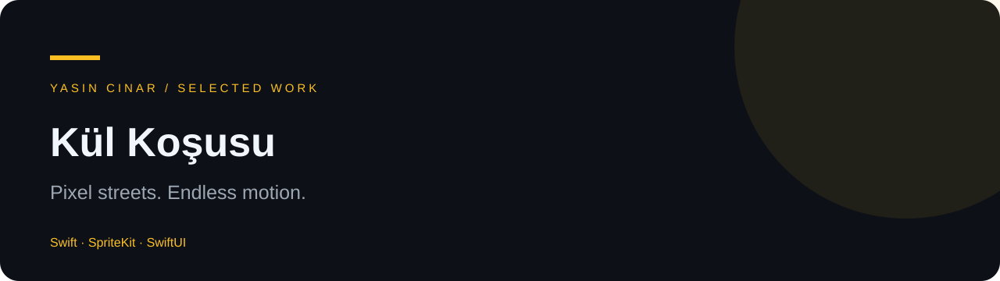

# Kül Koşusu

**Pixel streets. Endless motion.**

Mahalle mizahı, piksel görsellik ve refleks odaklı kontrolleri birleştiren sonsuz koşu oyunu.

## Öne çıkan deneyimler

- Zıplama, atılma ve vuruş kontrolleri
- Mahalle temalı karakterler ve sokak olayları
- Kıyafetler ve çevre temaları
- Görsel efektler, sesler ve oyun içi ilerleme

## Teknolojiler

Swift · SpriteKit · SwiftUI

## Bu depoda ne var?

Bu depo, projenin seçilmiş portfolyo sunumudur. Tam uygulama yerine ürün özeti ve üretim projesinden seçilmiş küçük kod örnekleri içerir. Örnekler tek başına çalıştırılabilir bir uygulama oluşturmaz.

Kimlik doğrulama yapılandırmaları, servis anahtarları, yönetim araçları, özel sunucu kodu, kullanıcı verileri ve dağıtım dosyaları bu depoya dahil değildir.

## Geliştiren

[Yasin Cinar](https://github.com/yancinarr) · [CinarVision](https://cinarvision.com)

Kod ve görseller açık kaynak lisansı altında sunulmamıştır. Kullanım izni için geliştiriciyle iletişime geçin.
